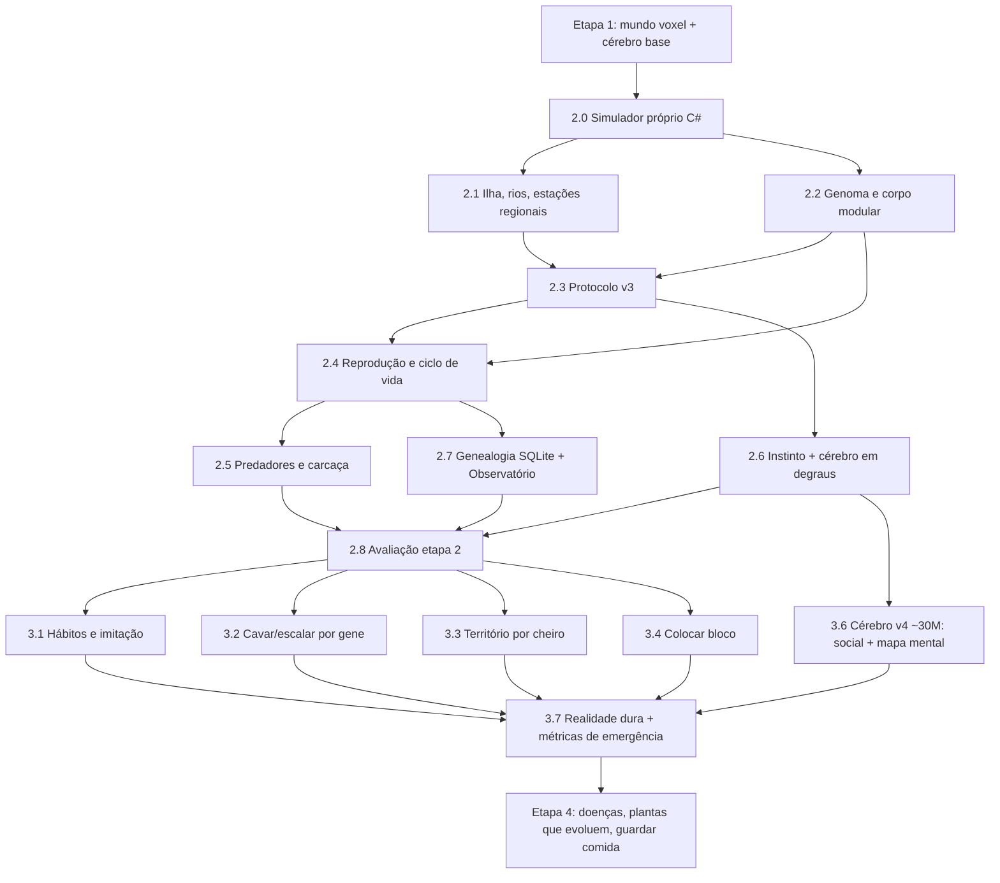

# Roteiro — fases e dependências

Objetivo: criaturas que evoluem como na teoria de Darwin (ver `CLAUDE.md`). Detalhe de cada decisão:
`docs/tasks/002-voxel-evolucao.md`. Regra: **cada etapa fecha com avaliação na seed 0 contra o aleatório e
para para mostrar ao usuário** antes da próxima.

Legenda: ✅ feito · ⏳ em andamento · ⬜ a fazer · `→` "precisa de"

## Etapa 1 — Mundo voxel + cérebro base ⏳
| # | Item | Depende de | Estado |
|---|---|---|---|
| 1a | Núcleo voxel (grade, gerador, malha, DDA, colisão, cavar) | — | ✅ |
| 1b | Godot sobre o voxel (sem física Godot) | 1a | ✅ |
| 1c | Protocolo v2 (1000 obs / 12 ações) + medo | 1b | ✅ |
| 1c' | Vegetação variada, criaturas em cubos, sala branca | 1a | ✅ |
| 1d | Cérebro v2 (MLP 0,65 M) treinado — referência | 1c | ✅ `v2-ppo-a` |
| 1d' | Cérebro v3 (GRU + curiosidade, 4 M) | 1c | ⏳ `v3-gru-a` |
| 1e | HUD leve + inspetor (Estado, Mente) | 1b | ⬜ |
| 1f | **Avaliação seed 0:** aleatório × v2 × v3 (vida ≥ 3×, comer/beber com fome/sede ≥ 2×) | 1d, 1d' | ⬜ |

## Etapa 2 — Genes, ilha, reprodução, predadores ⬜ (→ etapa 1 fechada)
| # | Item | Depende de |
|---|---|---|
| 2.0 | **Simulador próprio `CreatureIA.Sim`** (C# puro, mundos em paralelo; sentidos/plantas/criatura movidos para o Core; teste de paridade com Godot; ponte em memória compartilhada; cérebro em fp16 + GRU fundido) | etapa 1 |
| 2.1 | **Ilha grande sem borda:** oceano salgado, cordilheira, rios, lagos, clima por região, ano de 12 dias, estações por região, lagos que secam, fotoperíodo | 2.0 |
| 2.2 | **Genoma:** diploide mendeliano, sexo XY, crossover, mutação (taxa é gene), genes adormecidos, corpo modular voxel, custo Kleiber, acuidade dos sentidos, longevidade/maturidade/ninhada/senescência, hibernação | 2.0 |
| 2.3 | **Protocolo v3:** genes expressos + fotoperíodo + informação social mínima na observação | 2.1, 2.2 |
| 2.4 | **Reprodução e ciclo de vida:** acasalar, gestação/gema, crescimento, alimentar filhote, cio sazonal, população 150–250, arquivo anti-extinção, velhice; espécies iniciais A (3 anos) e B (20 anos) | 2.2, 2.3 |
| 2.5 | **Predadores:** carnívoros, mordida em criatura, carcaça vira carne, medo real | 2.4 |
| 2.6 | **Cérebro:** instinto por indivíduo (`ação = base + α(idade)·instinto`), genes como entrada, memória em janelas 256–512 | 2.3 |
| 2.7 | **Genealogia SQLite + Observatório** (Tab: Espécies, Genes, Genealogia; inspetor abas Genes/Família) | 2.4 |
| 2.8 | **Avaliação etapa 2:** sinal Baldwin, especiação inicial, r/K | 2.5, 2.6, 2.7 |

## Etapa 3 — Cultura e comportamento complexo ⬜ (→ 2.8)
| # | Item | Depende de |
|---|---|---|
| 3.1 | Hábitos por indivíduo + imitação de parentes | 2.6, 2.4 |
| 3.2 | Cavar/escalar com eficácia por gene (garras, força) | 2.2 |
| 3.3 | Território: marcar cheiro no chão | 2.3 |
| 3.4 | Ação "colocar bloco" (ninho, muro, dique) | 2.0 |
| 3.6 | **Cérebro v4 ~30 M** em degraus: codificador por sentido, atenção social, GRU 2×1024, mapa mental espacial (cada degrau só com ganho medido) | 2.6 |
| 3.7 | Modo "realidade dura" + métricas de emergência (bando, migração, toca, hábito noturno, especiação, nicho) | 3.1–3.6 |

## Etapa 4 — Ecologia avançada ⬜ (→ 3.7)
- Doenças e parasitas (imunidade por gene).
- Plantas que evoluem (coevolução), polinização.
- Guardar comida (ação carregar).

## Infra e hardware
- Treino: simulador próprio (2.0) no **desktop RTX 2060 6 GB** (24 h); notebook RTX 3050 para desenvolvimento.
- Checkpoints retomáveis permitem alternar máquinas.
