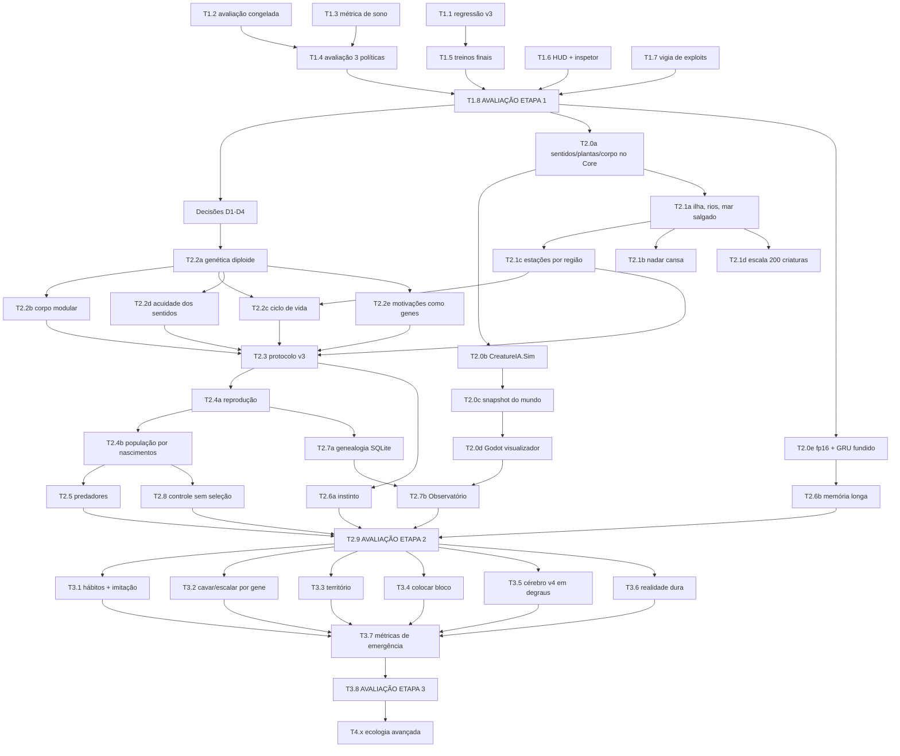

# Roteiro — fases, tasks e dependências

Objetivo: criaturas que evoluem como na teoria de Darwin (`CLAUDE.md`). Regra: **cada etapa fecha com
avaliação congelada na seed 0 contra o aleatório e para para mostrar ao usuário** antes da próxima.

| Etapa | Arquivo de tasks | Estado |
|---|---|---|
| 1 — Mundo voxel + cérebro base | `docs/tasks/003-etapa-1-fechamento.md` (T1.1–T1.8) | ⏳ fechamento |
| 2 — Simulador próprio, ilha, genes, reprodução, predadores | `docs/tasks/004-etapa-2.md` (D1–D4, T2.0–T2.9) | ⬜ |
| 3 — Cultura, comportamento complexo, cérebro v4 ~30 M | `docs/tasks/005-etapa-3.md` (T3.1–T3.8) | ⬜ |
| 4 — Ecologia avançada | `docs/tasks/006-etapa-4-e-transversais.md` (T4.1–T4.4) | ⬜ |
| Transversais | `docs/tasks/006-etapa-4-e-transversais.md` (TX.1–TX.6) | contínuo |

Registro das decisões de design: `docs/tasks/002-voxel-evolucao.md`.

**Caminho crítico até a evolução darwiniana funcionando:** T1.8 → T2.0a → T2.0b → (D1–D4) → T2.2a →
T2.3 → T2.4a → T2.4b → T2.8 → T2.9.

## Revisão do plano (2026-11-26): lacunas encontradas e onde foram tratadas
| # | Lacuna | Gravidade | Tratada em |
|---|---|---|---|
| 1 | Critério da etapa 1 pede "dormir com fadiga alta", mas o benchmark não mede sono | alta | T1.3 |
| 2 | Não existe avaliação congelada: o cérebro continua aprendendo durante a avaliação (contamina o resultado) | alta | T1.2 |
| 3 | O benchmark compara só 2 políticas; a etapa 1 precisa de aleatório × v2 × v3 | média | T1.4 |
| 4 | Regressão do v3 (vida média caindo) sem diagnóstico | alta | T1.1 |
| 5 | **Recompensa só homeostática não motiva acasalar nem cuidar de filhote**: sem isso, reprodução e cuidado parental não aparecem | **crítica** | D3 + T2.2e |
| 6 | **O mundo não persiste:** só o cérebro tem checkpoint; evolução de anos precisa de snapshot do mundo e da população | **crítica** | T2.0c |
| 7 | Como assistir uma população que evolui dentro do simulador próprio (sem Godot) não estava definido | alta | D4 + T2.0d |
| 8 | Espécies iniciais contraditórias ("herbívoro + carnívoro" × "A 3 anos, B 20 anos") | média | D1 |
| 9 | Dono da genética contraditório (Python no plano antigo × simulador C#) | média | D2 |
| 10 | Teto de população (64 × 150–250) e escala do mapa (384 × 768) contraditórios | baixa | corrigido no 002 |
| 11 | Faltava controle científico: provar que a mudança de genes vem da seleção, e não de deriva | alta | T2.8 |
| 12 | Afogamento e mar aberto não especificados (fronteira natural da ilha) | média | T2.1b |
| 13 | Métricas de emergência sem definição operacional (como medir "migração", "bando") | alta | T3.7 |
| 14 | Checkpoints fora do git sem caminho até o desktop da RTX 2060 | média | TX.2 |
| 15 | Sem CI: os testes só rodam na mão | baixa | TX.1 |
| 16 | Sem orçamento de desempenho por etapa (risco de ficar lento sem perceber) | média | TX.4, T2.1d |
| 17 | Etapa 2 descrita duas vezes no 002 (original + ampliações) | baixa | unificada em 004 |
